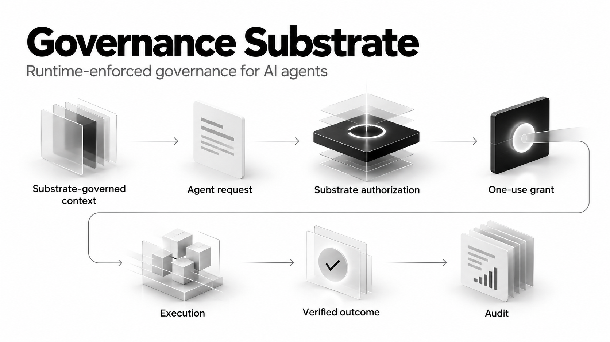

# Governance Substrate

**Governance belongs beneath the model, enforced by the system.**

Governance Substrate is a runtime layer that enforces what AI agents can access, change, retain, and publish — outside the model, at the system boundary.

> **Technical architecture:** [Substrate Reference Architecture](docs/Substrate-Reference-Architecture.md)

Current source version: [v0.7.0](https://github.com/electricwolfemarshmallowhypertext/gov-substrate/tree/v0.7.0)

> **TL;DR:** Agent intent is not authority. Governance Substrate places permissions, execution control, provenance, and audit beneath the agent so the system — not the prompt — decides what actions are allowed.

## Demonstrated result

Governance Substrate was tested in a real Docker deployment. The agent runs in its own locked-down container. It cannot reach the network, the files, or the secrets directly. Its only way to do anything is to ask the substrate, and the substrate decides.

- **Hostile worker.** A compromised agent sent 20 forbidden requests: reading secret files, writing protected files, and reaching services it was not granted. All 20 were denied and logged.
- **Going around the substrate.** From inside the agent's container, 54 attempts to bypass the substrate (network, Docker socket, secrets, files, privileges) all failed. The one legitimate route still worked.
- **Live AI model.** A model completed a normal task through the substrate. When a request was outside its grants (a write it was not allowed to make, the protected secrets file, an unauthorized export), the substrate refused it, nothing happened, and no secret reached the model.
- **Email and grants.** A mail server received one authorized email. A replayed request and a revoked grant sent nothing more.
- **Audit.** Every decision logged. The log was independently recomputed from the raw events, and a separate container holds its own copy of the chain.

Runs where the model never asked for the forbidden action are recorded as "no attempt" and are not counted as evidence.

Receipts for these runs are in [`docs/evidence/receipts`](docs/evidence/receipts), with their hashes in [`docs/evidence/Deployment-Repair-Manifest.json`](docs/evidence/Deployment-Repair-Manifest.json).

## How it works

`substrate-governed context → agent request → substrate authorization → one-use grant → execution → verified outcome → audit`

The substrate governs context supplied to generation, checks authority before execution, mediates governed capabilities, records what happened, and verifies the result. Agent intent does not create authority.

## Evidence

The project separates policy tests from real runtime evidence. Evaluation includes runtime conformance, hostile-worker enforcement, model integration, hosted-provider validation, incident-derived failure cases, and compromised-host/provider scenarios.

Start with the [research case and evidence](docs/Research-Case-and-Evidence.md). The canonical empirical baseline is the [Phase 10 evidence freeze](docs/evidence/Evidence-Freeze-2026-10-05.md).

## Research

**Governance as Substrate: Engineering Patterns for Resilient Collective Systems — V2, September 2026 Revision**

- [Research paper DOI](https://doi.org/10.5281/zenodo.23002435)
- [v0.6.0 release notes](docs/releases/Release-v0.6.0.md)

## Scope

The evidence applies to the documented reference configuration and tested scenarios; it does not establish universal AI confinement or prove every runtime backend.

## License

The software source code is licensed under the [GNU Affero General Public License v3.0 or later](LICENSE) (`AGPL-3.0-or-later`). Copyright © 2026 Antiparty Inc.

Organizations that want to incorporate Governance Substrate into proprietary products or services without AGPL obligations may request a separate commercial license from [smith@antiparty.co](mailto:smith@antiparty.co).

The Governance Substrate name, associated branding, trademarks, research papers, and prose documentation are not licensed under the software license unless expressly stated.
